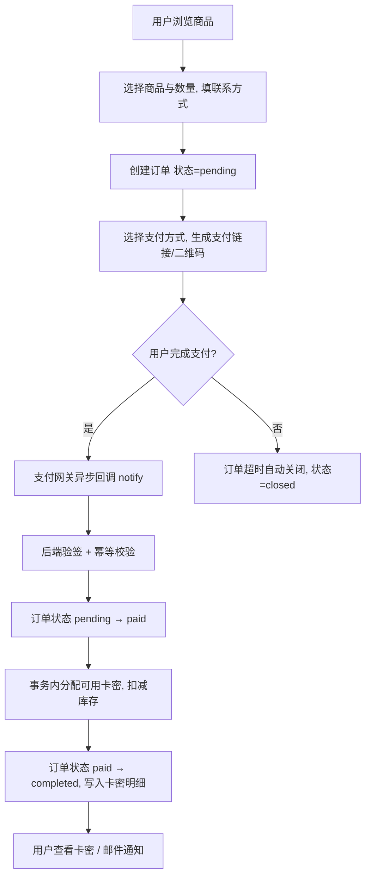
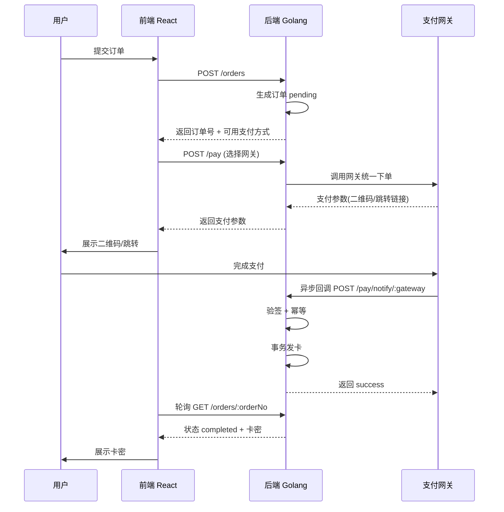
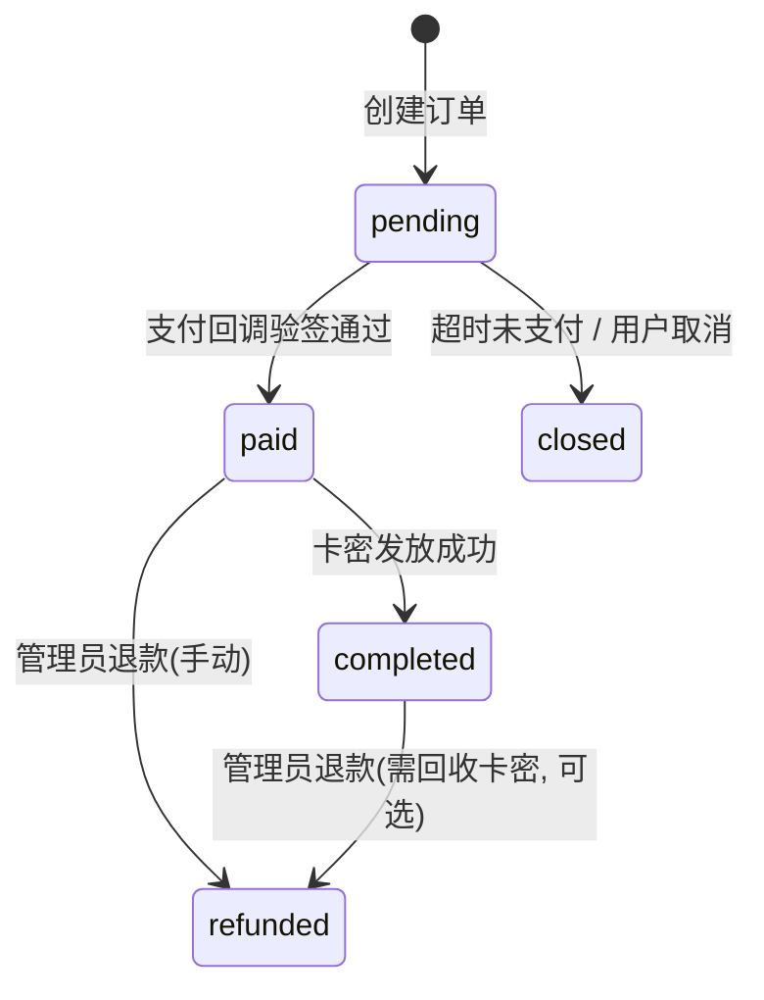
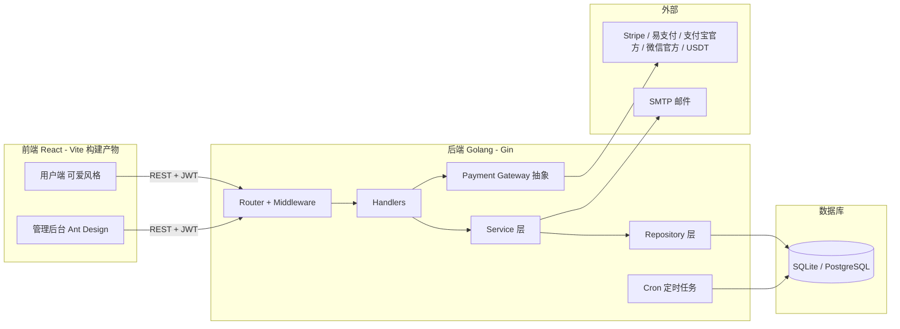
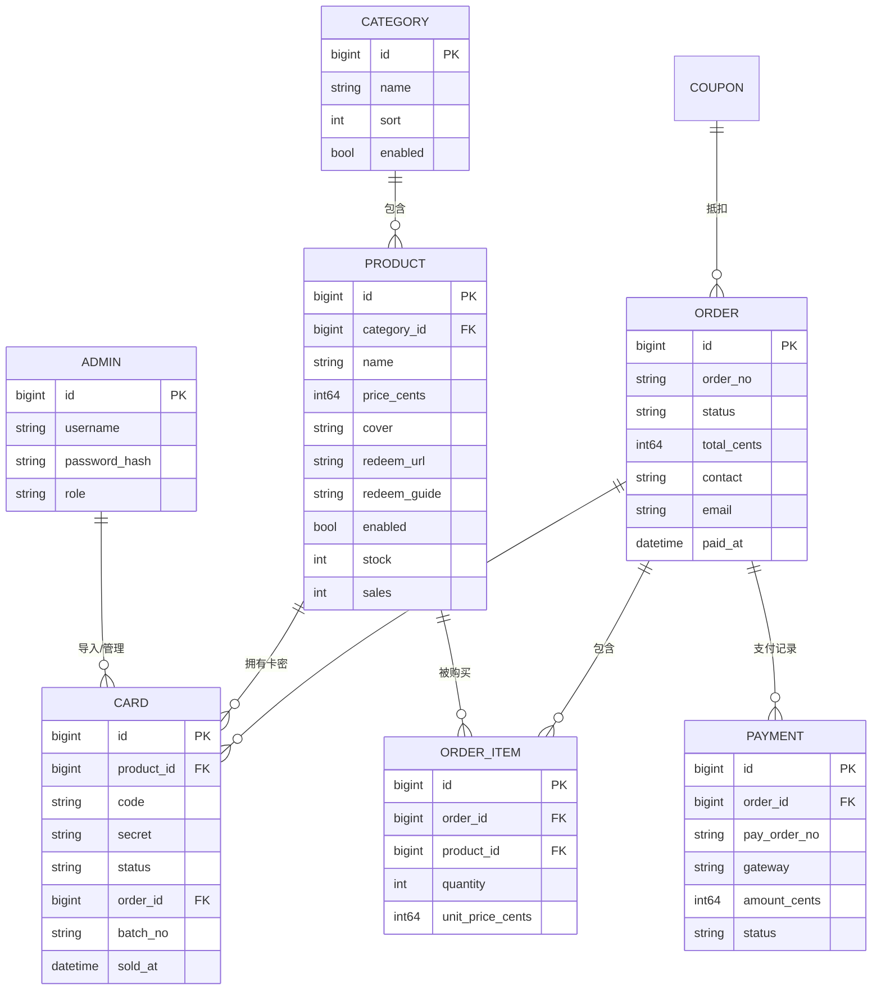

# 望月AI代充小铺（Wybo）开发文档

> 自动发卡网 · 深度设计与实施方案
>
> - 项目代号 / 品牌名：**Wybo**
> - 系统名称：**望月AI代充小铺**
> - 定位：AI 会员（ChatGPT / Claude / Grok 等）自动发卡（卡密/CDK）代充平台
> - 技术栈：React（前端）+ Golang（后端）+ SQLite / PostgreSQL（数据库）
> - 视觉风格：可爱、卡通、望月（凝望月亮的小兔子）主题

---

## 目录

1. [项目概述](#1-项目概述)
2. [需求分析](#2-需求分析)
3. [核心业务：CDK 发卡闭环](#3-核心业务cdk-发卡闭环)
4. [技术选型与理由](#4-技术选型与理由)
5. [系统架构](#5-系统架构)
6. [数据库设计](#6-数据库设计)
7. [API 设计](#7-api-设计)
8. [支付网关集成](#8-支付网关集成)
9. [前端页面与 UI/UX 设计](#9-前端页面与-uiux-设计)
10. [Logo 与 ICO 设计](#10-logo-与-ico-设计)
11. [安全设计](#11-安全设计)
12. [项目目录结构](#12-项目目录结构)
13. [关键代码骨架](#13-关键代码骨架)
14. [开发里程碑](#14-开发里程碑)
15. [部署说明（非 Docker）](#15-部署说明非-docker)
16. [附录：主流发卡项目对比](#16-附录主流发卡项目对比)

---

## 1. 项目概述

### 1.1 一句话定位

Wybo 是一个面向 AI 会员充值场景的**自动化发卡（卡密/CDK 售卖）平台**：用户在平台选购 ChatGPT / Claude / Grok 等会员，在线支付成功后系统**自动发放一条卡密（CDK）**，用户凭卡密前往指定官网完成兑换。

### 1.2 与「代充」的区别（重要）

本产品本质是 **发卡网（卡密售发）**，而非人工代充：

- **发卡模式（本项目采用）**：用户付款 → 系统即时自动出卡密 → 用户自行到官网兑换。全程无人值守，边际成本低，可 7×24 小时自动成交。
- 人工代充模式：用户付款 → 人工登录用户账号代充，涉及账号密码托管，风险高、无法自动化，**不在本期范围**。

因此「代充小铺」更多是品牌名称，核心交易形态是 **CDK/卡密自动发放**。文档后续均以卡密发放为核心展开。

### 1.3 核心价值

| 维度 | 说明 |
|------|------|
| 自动化 | 支付回调后毫秒级自动出卡，无需人工值守 |
| 安全 | 支付回调验签、卡密事务发放防超卖、防重复发放 |
| 易运营 | 卡密批量导入、库存实时看板、订单/卡密一键导出 |
| 低成本 | SQLite 零依赖部署，单二进制 + 静态前端即可上线 |

---

## 2. 需求分析

### 2.1 目标用户

- **C 端用户**：需要购买 ChatGPT Plus、Claude Pro、Grok 等 AI 会员的普通用户（多无境外支付能力，或偏好便捷兑换）。
- **B 端 / 运营者**：站长本人，负责商品上架、卡密进货导入、订单与售后。

### 2.2 角色与用例

**访客（匿名下单，不开放注册）**

- 浏览商品分类与商品列表/详情
- 查看公告、站点客服信息
- 提交订单（选商品、数量、填写联系方式：邮箱/手机号）
- 选择支付方式并支付（Stripe / 易支付 / 支付宝官方 / 微信官方 / USDT）
- 支付成功后查看订单详情与**已发放的卡密**
- 通过「卡密查询」页面（订单号 + 联系方式）找回卡密

**管理员（后台）**

- 登录后台（账号密码 + 可选二次验证）
- 商品管理（增删改查、上下架、分类）
- 卡密管理（批量导入、查看状态、导出、失效/删除）
- 订单管理（查询、标记、退款、人工补卡）
- 支付方式管理（启用/停用、密钥配置）
- 优惠券 / 公告 / 站点设置管理
- 仪表盘（今日订单、销售额、库存告警）

### 2.3 功能清单（优先级）

| 模块 | 功能 | 优先级 |
|------|------|--------|
| 商品 | 分类、列表、详情、上下架、库存展示 | P0 |
| 订单 | 创建、支付、状态机、查询 | P0 |
| 卡密 | 批量导入、自动发放、状态管理 | P0 |
| 支付 | 支付网关抽象 + Stripe/易支付/支付宝官方/微信官方/USDT 适配、回调验签 | P0 |
| 卡密查询 | 订单号 + 联系方式找回卡密 | P0 |
| 后台 | 登录、仪表盘、商品/卡密/订单管理 | P0 |
| 站点 | 名称/Logo/公告/客服配置 | P1 |
| 优惠券 | 满减/折扣券 | P1 |
| 统计 | 销售趋势、商品热销榜 | P2 |
| 邮件通知 | 支付成功邮件（含卡密） | P2 |

### 2.4 非功能需求

- **性能**：出卡接口（支付回调）P99 < 500ms；商品列表页首屏 < 1.5s。
- **并发**：单实例 SQLite 下需保证卡密发放原子性，避免超卖。
- **安全**：支付验签、防重放、防刷单、SQL 注入/XSS 防护。
- **可维护**：前后端分离，接口 RESTful，配置与代码分离。
- **可迁移**：GORM 抽象，SQLite 可无痛升级为 PostgreSQL。

---

## 3. 核心业务：CDK 发卡闭环

### 3.1 整体流程图



### 3.2 支付时序图



### 3.3 订单状态机



状态定义：

| 状态 | 含义 | 可执行动作 |
|------|------|-----------|
| `pending` | 待支付 | 支付、取消、超时关闭 |
| `paid` | 已支付待发卡 | 发卡（自动） |
| `completed` | 已完成（已出卡） | 查看卡密 |
| `closed` | 已关闭（超时/取消） | 无 |
| `refunded` | 已退款 | 无 |

### 3.4 防超卖与防重复发放（核心难点）

发卡网最关键的工程问题有两个：**卡密超卖** 与 **回调重复发放**。方案：

1. **库存 = 实时可售卡密数**：`available` 状态卡密数量，下单时仅校验不锁定；真正扣减发生在支付成功回调。
2. **发卡使用数据库事务 + 行级锁定**：

```sql
-- 事务内：先取 N 条可用卡密并锁定，再更新为已售
BEGIN;
SELECT id, code, secret FROM cards
WHERE product_id = ? AND status = 'available'
ORDER BY id ASC LIMIT ? FOR UPDATE;   -- PostgreSQL
-- SQLite 下以「先更新后回读」或乐观锁实现，见 13 节
UPDATE cards SET status='sold', order_id=?, sold_at=now()
WHERE id IN (...取出的 ids...);
COMMIT;
```

3. **回调幂等**：以 `pay_order_no`（第三方支付流水号）做唯一索引。收到重复回调时，若订单已 `completed` 直接返回 `success`，不再重复发卡。
4. **超时关单**：后台 cron 定时任务扫描超过 N 分钟的 `pending` 订单置为 `closed`（本期不锁定库存，故无需释放库存）。
5. **库存不足熔断**：回调发卡时若 `available` 不足，订单置为 `paid` 并进入「待补卡」异常队列，通知管理员补卡/退款，避免静默丢单。

---

## 4. 技术选型与理由

| 层 | 选型 | 理由 |
|----|------|------|
| 前端框架 | React 18 + TypeScript | 生态成熟、组件化、类型安全 |
| 前端构建 | Vite | 秒级冷启动、HMR 快、配置简单 |
| UI 组件 | 自研「可爱卡通」组件 + Tailwind CSS；后台用 Ant Design | 前台走定制化可爱风格，后台用成熟中后台组件提效 |
| 状态管理 | Zustand | 轻量、无样板代码 |
| 请求/缓存 | axios + TanStack Query | 统一拦截器 + 数据缓存/轮询 |
| 路由 | react-router-dom v6 | 事实标准 |
| 后端语言 | Golang | 高并发、单二进制部署、适合支付高频回调 |
| Web 框架 | Gin | 成熟、中间件生态好、性能高 |
| ORM | GORM v2 | 自动迁移、SQLite/PG 无缝切换、事务方便 |
| 认证 | JWT（golang-jwt）+ bcrypt | 无状态鉴权，适合前后端分离 |
| 配置 | Viper | YAML/ENV 双支持 |
| 定时任务 | robfig/cron | 关单、库存告警等 |
| 日志 | zap（或 slog） | 结构化、高性能 |
| 数据库 | SQLite（本地开发）/ PostgreSQL（正式环境） | GORM 免改代码，环境变量一键切换 |
| 支付 | 自研 Gateway 抽象 | 一套接口适配 Stripe/易支付/支付宝官方/微信官方/USDT |

**数据库选型（已确认）**：**本地开发用 SQLite**（免安装、备份=拷文件），**正式环境用 PostgreSQL（pgsql）**。两者在 GORM 下共享同一套模型与迁移逻辑，仅通过 `DB_DRIVER` 环境变量切换，业务代码零改动。

---

## 5. 系统架构

### 5.1 架构图



### 5.2 后端分层

| 层 | 职责 | 示例 |
|----|------|------|
| `router` | 路由注册、中间件编排 | `/api/v1/products` |
| `handler` | 参数绑定/校验、响应封装 | `ProductHandler.List` |
| `service` | 业务逻辑、事务编排 | `OrderService.Create` / `DeliverCards` |
| `repository` | 数据访问 | `CardRepo.ClaimN` |
| `model` | GORM 模型、常量、枚举 | `Order`, `Card`, `Status` |
| `pay` | 支付网关抽象与实现 | `Gateway` 接口 + `Epay`/`Stripe`/`Alipay`/`Wechat`/`Usdt` |

---

## 6. 数据库设计

> 命名统一：表名复数 snake_case，时间字段 `created_at` / `updated_at`，金额单位统一为「分」（int64），避免浮点误差。

### 6.1 ER 关系



### 6.2 表结构明细

#### `admins` 管理员

| 字段 | 类型 | 说明 |
|------|------|------|
| id | BIGINT PK | 自增 |
| username | VARCHAR(64) UNIQUE | 登录名 |
| password_hash | VARCHAR(255) | bcrypt |
| role | VARCHAR(16) | `super` / `operator` |
| last_login_at | DATETIME | |
| created_at / updated_at | DATETIME | |

#### `categories` 商品分类

| 字段 | 类型 | 说明 |
|------|------|------|
| id | BIGINT PK | |
| name | VARCHAR(64) | 如「ChatGPT」「Claude」「Grok」 |
| icon | VARCHAR(255) | 分类图标 |
| sort | INT | 排序，越小越靠前 |
| enabled | BOOL | |
| created_at / updated_at | DATETIME | |

#### `products` 商品

| 字段 | 类型 | 说明 |
|------|------|------|
| id | BIGINT PK | |
| category_id | BIGINT FK | |
| name | VARCHAR(128) | 如「ChatGPT Plus 会员一个月」 |
| description | TEXT | 富文本/说明 |
| cover | VARCHAR(255) | 封面图 |
| price_cents | BIGINT | 单价（分） |
| original_price_cents | BIGINT | 划线原价 |
| redeem_url | VARCHAR(255) | 兑换网址（用户兑换卡密处） |
| redeem_guide | TEXT | 兑换教程 |
| stock | INT | 冗余库存（=available 卡密数） |
| sales | INT | 累计销量 |
| enabled | BOOL | 上下架 |
| sort | INT | |
| created_at / updated_at | DATETIME | |

#### `cards` 卡密/CDK

| 字段 | 类型 | 说明 |
|------|------|------|
| id | BIGINT PK | |
| product_id | BIGINT FK | 所属商品 |
| code | VARCHAR(255) | 卡密正文（CDK/兑换码） |
| secret | VARCHAR(255) | 卡密密码/备注（可空，兼容「账号+密码」卡） |
| status | VARCHAR(16) | `available` / `sold` / `disabled` |
| order_id | BIGINT | 售出订单（NULL 表示未售） |
| batch_no | VARCHAR(64) | 导入批次号 |
| sold_at | DATETIME | |
| created_at / updated_at | DATETIME | |

索引：`(product_id, status)` 复合索引，支撑「按商品取可用卡密」。

> **卡密格式（已确认）**：支持两种——① 单码（仅 `code`，`secret` 留空）；② 账号+密码（`code` 为账号、`secret` 为密码）。**导入自动查重**：批量导入时按 `(product_id, code)` 校验，已存在则跳过并提示重复，避免同一卡密重复入库；重复项可在导入预览中查看。

#### `orders` 订单

| 字段 | 类型 | 说明 |
|------|------|------|
| id | BIGINT PK | |
| order_no | VARCHAR(32) UNIQUE | 业务单号（对外展示） |
| status | VARCHAR(16) | `pending/paid/completed/closed/refunded` |
| total_cents | BIGINT | 实付金额（分） |
| discount_cents | BIGINT | 优惠金额 |
| contact | VARCHAR(128) | 联系方式（邮箱/手机） |
| email | VARCHAR(128) | 通知邮箱 |
| coupon_id | BIGINT NULL | |
| pay_method | VARCHAR(32) | 支付网关标识 |
| paid_at | DATETIME | |
| expired_at | DATETIME | 超时关闭时间 |
| created_at / updated_at | DATETIME | |

#### `order_items` 订单明细

| 字段 | 类型 | 说明 |
|------|------|------|
| id | BIGINT PK | |
| order_id | BIGINT FK | |
| product_id | BIGINT FK | |
| product_name | VARCHAR(128) | 下单时快照 |
| quantity | INT | |
| unit_price_cents | BIGINT | 下单时快照 |

> 卡密直接挂在 `cards.order_id` 上，无需单独的发放明细表；如需更细可增加 `card_deliveries`。

#### `payments` 支付记录

| 字段 | 类型 | 说明 |
|------|------|------|
| id | BIGINT PK | |
| order_id | BIGINT FK | |
| pay_order_no | VARCHAR(64) UNIQUE | 第三方支付流水号（幂等键） |
| gateway | VARCHAR(32) | `epay` / `stripe` / `hupijiao` |
| amount_cents | BIGINT | |
| status | VARCHAR(16) | `created/success/failed` |
| raw | TEXT | 回调原始报文（审计） |
| paid_at | DATETIME | |
| created_at / updated_at | DATETIME | |

#### `coupons` 优惠券

| 字段 | 类型 | 说明 |
|------|------|------|
| id | BIGINT PK | |
| code | VARCHAR(32) UNIQUE | |
| type | VARCHAR(16) | `fixed`（满减）/ `percent`（折扣） |
| value | INT | 面额（分）或折扣（如 90 = 9 折） |
| min_amount_cents | BIGINT | 使用门槛 |
| start_at / end_at | DATETIME | 有效期 |
| total / used | INT | 总张数 / 已用 |
| enabled | BOOL | |

#### `announcements` 公告

| 字段 | 类型 | 说明 |
|------|------|------|
| id | BIGINT PK | |
| title | VARCHAR(128) | |
| content | TEXT | |
| sort | INT | |
| enabled | BOOL | |
| created_at / updated_at | DATETIME | |

#### `settings` 站点配置（KV）

| 字段 | 类型 | 说明 |
|------|------|------|
| key | VARCHAR(64) PK | 如 `site_name`, `site_logo`, `customer_service` |
| value | TEXT | JSON 或字符串 |

---

## 7. API 设计

统一前缀 `/api/v1`，返回结构：

```json
{ "code": 0, "message": "ok", "data": {} }
```

`code=0` 成功；非 0 为业务错误码。管理端接口需 `Authorization: Bearer <token>`。

### 7.1 公开接口（用户端）

| 方法 | 路径 | 说明 |
|------|------|------|
| GET | `/site` | 站点信息（名称/Logo/公告/客服） |
| GET | `/categories` | 分类列表 |
| GET | `/products` | 商品列表（`category_id`/`page`/`size`/`keyword`） |
| GET | `/products/:id` | 商品详情（含库存、兑换说明） |
| GET | `/announcements` | 公告列表 |
| POST | `/orders` | 创建订单（`product_id`,`quantity`,`contact`,`coupon_code?`） |
| GET | `/orders/:order_no` | 查询订单（含已发卡密） |
| POST | `/orders/:order_no/cancel` | 取消订单 |
| POST | `/orders/:order_no/pay` | 发起支付（`gateway`）→ 返回支付参数 |
| POST | `/pay/notify/:gateway` | 支付异步回调（网关调用） |
| GET | `/pay/return` | 支付同步跳转页 |
| GET | `/query` | 卡密查询（`order_no` + `contact`） |

### 7.2 管理端接口（JWT）

| 方法 | 路径 | 说明 |
|------|------|------|
| POST | `/admin/login` | 登录，返回 JWT |
| GET | `/admin/dashboard` | 今日订单/销售额/库存告警 |
| GET/POST/PUT/DELETE | `/admin/categories` | 分类 CRUD |
| GET/POST/PUT/DELETE | `/admin/products` | 商品 CRUD |
| GET | `/admin/cards` | 卡密列表（可按 `product_id/status/batch_no` 过滤） |
| POST | `/admin/cards/import` | 批量导入（文本/CSV，一行一码，支持 `code,secret`） |
| POST | `/admin/cards/export` | 导出（可选） |
| POST | `/admin/cards/:id/disable` | 失效单张卡密 |
| GET | `/admin/orders` | 订单列表 |
| PUT | `/admin/orders/:id/status` | 改状态（补卡/退款） |
| GET/POST/PUT/DELETE | `/admin/coupons` | 优惠券 CRUD |
| GET/POST/PUT/DELETE | `/admin/announcements` | 公告 CRUD |
| GET/PUT | `/admin/settings` | 站点与支付配置 |
| GET/PUT | `/admin/gateways` | 支付方式启用与密钥配置 |

### 7.3 关键接口示例

**创建订单**

```
POST /api/v1/orders
{ "product_id": 1, "quantity": 2, "contact": "user@example.com", "coupon_code": "" }
→ { "code": 0, "data": { "order_no": "20261031XXXX", "total_cents": 19800, "expired_at": "..." } }
```

**发起支付（易支付示例）**

```
POST /api/v1/orders/{orderNo}/pay
{ "gateway": "epay" }
→ { "code": 0, "data": { "pay_url": "https://pay.example.com/submit.php?...", "qr": "...", "type": "url|qr" } }
```

**查询订单（用户查卡密）**

```
GET /api/v1/orders/{orderNo}?contact=user@example.com
→ { "code": 0, "data": { "order_no": "...", "status": "completed",
      "items": [{ "name": "ChatGPT Plus 一个月", "quantity": 2 }],
      "cards": [ { "code": "CDK-XXXX", "secret": "" }, ... ] } }
```

> 卡密仅在 `status ∈ {completed}` 时返回，且校验 `contact` 匹配，防止越权窃取卡密。

---

## 8. 支付网关集成

### 8.1 抽象接口

```go
// pay/gateway.go
type Gateway interface {
    Name() string
    // 统一下单，返回支付参数
    CreateOrder(ctx context.Context, req *CreateReq) (*CreateResp, error)
    // 解析并验签异步回调
    ParseNotify(ctx context.Context, req *http.Request) (*Notify, error)
    // 主动查询订单状态（对账/补单）
    QueryOrder(ctx context.Context, payOrderNo string) (*QueryResp, error)
}
```

### 8.2 网关实现规划

| 网关 | 适用 | 说明 |
|------|------|------|
| Stripe | 海外信用卡 | 面向海外用户，美元结算 |
| 易支付（epay） | 国内聚合 | 微信/支付宝聚合，站长自备易支付账号 |
| 支付宝官方（alipay） | 国内 | 当面付/电脑网站支付，需企业资质 |
| 微信官方（wechat） | 国内 | Native/JSAPI 支付，需商户号 |
| USDT | 币圈用户 | 虚拟币收款，支持 TRC-20/ERC-20 |

> **首发支付渠道（已确认）**：Stripe、易支付、支付宝官方、微信官方、USDT 五类。支付网关配置以 `gateways` 表动态管理，新增网关只需实现 `Gateway` 接口，业务层零改动。

### 8.3 回调安全与幂等（必读）

- **验签**：按网关算法（如易支付的 `md5(参数按 key 排序 + KEY)`）核对签名，失败直接丢弃并记日志。
- **幂等**：以 `payments.pay_order_no` 唯一约束 + `INSERT ... ON CONFLICT DO NOTHING` 保证同一流水只处理一次。
- **金额核对**：回调金额必须与订单金额一致，否则拒绝并告警。
- **返回**：处理成功返回网关约定的成功字符串（易支付为 `success`），否则网关会重试。

---

## 9. 前端页面与 UI/UX 设计

### 9.1 页面清单

**用户端（可爱卡通风）**

| 页面 | 路由 | 要点 |
|------|------|------|
| 首页 | `/` | 顶部月亮 Logo、公告轮播、分类快捷入口、热销商品瀑布流 |
| 商品列表 | `/products` | 左侧分类、卡片式商品、价格/库存标签 |
| 商品详情 | `/products/:id` | 大图、价格、库存、兑换教程折叠、立即购买 |
| 结算/下单 | `/checkout` | 数量选择、优惠券、联系方式、订单确认 |
| 支付页 | `/pay/:orderNo` | 二维码/跳转按钮、支付倒计时、状态轮询 |
| 支付结果 | `/pay/result` | 成功撒花动画 + 卡密列表 + 复制按钮 |
| 卡密查询 | `/query` | 订单号 + 联系方式 → 找回卡密 |

**管理后台（Ant Design，独立于前台）**

| 页面 | 路由 | 要点 |
|------|------|------|
| 登录 | `/admin/login` | |
| 仪表盘 | `/admin` | 统计卡片 + 趋势图 |
| 商品/分类 | `/admin/products` | 表格 + 表单抽屉 |
| 卡密管理 | `/admin/cards` | 批量导入、状态筛选、导出 |
| 订单管理 | `/admin/orders` | 状态筛选、人工补卡/退款 |
| 优惠券/公告 | `/admin/coupons` 等 | |
| 支付设置 | `/admin/gateways` | 网关开关与密钥 |
| 站点设置 | `/admin/settings` | Logo 上传、名称、客服 |

### 9.2 可爱卡通风格规范

| 项 | 规范 |
|----|------|
| 主色 | 夜空蓝紫 `#3D3A8C`（主）/ 奶油黄 `#FFD166`（点缀）/ 樱粉 `#FF9EC4`（强调） |
| 背景 | 柔和米白 `#FFF8F0`，卡片纯白 + 大圆角 `16px` |
| 圆角 | 卡片 16px、按钮 999px（胶囊） |
| 阴影 | 柔和 `0 6px 18px rgba(61,58,140,.10)` |
| 字体 | 圆体优先：MiSans / HarmonyOS Sans / 系统圆体；标题加粗圆润 |
| 图标/插画 | 统一线面结合可爱风（兔子、月亮、云朵、星星），emoji 点缀 |
| 动效 | 按钮 hover 轻微上浮 + 弹跳；支付成功撒星/月亮升起动画 |
| 文案 | 亲切语气，如「抱抱，正在为你准备卡密～」「兑换好啦！🎉」 |

### 9.3 响应式与可访问性

- 桌面优先，兼顾移动端（H5）下单与支付。
- 颜色对比度、按钮可点击区域 ≥ 44px、键盘可聚焦。
- 首屏图片懒加载、路由懒加载、gzip/brotli 静态压缩。

---

## 10. Logo 与 ICO 设计

### 10.1 设计理念

**「望月」= 一只凝望月亮的小兔子**，与 AI 代充的「智能、陪伴、可爱」气质契合。主图形元素：**月亮 + 兔子 + 星星/云朵**。

- 主视觉：一轮**微笑的弯月（暖黄）**，月亮怀抱里坐着一只**可爱的圆耳小兔子**，抬头仰望星空；旁边点缀星星与云朵。
- 文字标：`Wybo` 圆润无衬线 + 中文副标「望月AI代充小铺」。
- ICO/图标：简化的「弯月 + 兔耳」剪影，保证 16px 小尺寸仍可辨识。

### 10.2 配色表

| 用途 | 色值 | 说明 |
|------|------|------|
| 夜空深蓝紫 | `#3D3A8C` | 主色/文字 |
| 奶油月亮黄 | `#FFD166` | 月亮主图形 |
| 樱粉 | `#FF9EC4` | 兔子/强调色 |
| 云朵白 | `#FFFFFF` | 云朵/留白 |
| 星光浅蓝 | `#A8D8EA` | 星星点缀 |

### 10.3 尺寸与格式

| 文件 | 尺寸 | 格式 |
|------|------|------|
| favicon.ico | 16/32/48 多尺寸 | ICO |
| apple-touch-icon | 180×180 | PNG |
| Logo 横版 | 约 400×120 | SVG/PNG |
| Logo 方形（App/二维码中心） | 512×512 | PNG |
| 后台 Logo | 40×40 | PNG/SVG |

### 10.4 图标 SVG 概念稿（可直接用于 favicon 起步）

```svg
<svg xmlns="http://www.w3.org/2000/svg" viewBox="0 0 128 128">
  <defs>
    <linearGradient id="bg" x1="0" y1="0" x2="0" y2="1">
      <stop offset="0" stop-color="#3D3A8C"/>
      <stop offset="1" stop-color="#5A55B8"/>
    </linearGradient>
  </defs>
  <rect width="128" height="128" rx="30" fill="url(#bg)"/>
  <!-- 星星 -->
  <circle cx="100" cy="26" r="3.5" fill="#A8D8EA"/>
  <circle cx="112" cy="46" r="2.5" fill="#FFFFFF"/>
  <circle cx="22" cy="96" r="3" fill="#A8D8EA"/>
  <!-- 微笑弯月 -->
  <path d="M78 26a32 32 0 1 0 32 38 26 26 0 1 1-32-38z" fill="#FFD166"/>
  <!-- 小兔子 -->
  <g transform="translate(26,52)">
    <ellipse cx="16" cy="10" rx="9" ry="11" fill="#FF9EC4"/> <!-- 左耳 -->
    <ellipse cx="30" cy="10" rx="9" ry="11" fill="#FF9EC4"/> <!-- 右耳 -->
    <circle cx="23" cy="34" r="20" fill="#FFFFFF"/>          <!-- 头 -->
    <circle cx="16" cy="32" r="2.4" fill="#3D3A8C"/>         <!-- 左眼 -->
    <circle cx="30" cy="32" r="2.4" fill="#3D3A8C"/>         <!-- 右眼 -->
    <ellipse cx="23" cy="38" rx="2.2" ry="1.6" fill="#FF9EC4"/> <!-- 鼻 -->
  </g>
</svg>
```

> 以上为概念稿，正式版建议由 UI/插画师按此方向绘制完整 Logo（月亮、兔子、云朵、文字标），并导出全套 ICO/PNG/SVG。

---

## 11. 安全设计

| 风险 | 对策 |
|------|------|
| 卡密越权查看 | 查询接口必须校验 `order_no + contact` 双重匹配；管理端 JWT 鉴权 + RBAC |
| 支付回调伪造 | 网关验签 + 金额核对 + IP 白名单（可选） |
| 回调重放/重复发卡 | `pay_order_no` 唯一约束 + 幂等处理 |
| 卡密超卖 | 事务 + 行锁 + 库存熔断 + 补卡队列 |
| 刷单/刷接口 | 下单频率限制（同 IP/联系方式）、验证码（可选）、限流中间件 |
| SQL 注入 | 全部走 GORM 参数化 |
| XSS | 前端框架默认转义 + 后端输入校验/清洗富文本 |
| 密码泄露 | bcrypt 哈希 + JWT 短过期 + 刷新令牌 |
| 卡密明文泄露 | 日志脱敏（卡密部分打码）；数据库可加密存储（可选） |
| 中间人 | 全站 HTTPS，配置 HSTS |

---

## 12. 项目目录结构

```
Wybo/
├── backend/                       # Golang 后端
│   ├── cmd/
│   │   └── server/main.go         # 入口
│   ├── internal/
│   │   ├── config/                # Viper 配置加载
│   │   ├── model/                 # GORM 模型 + 常量/枚举
│   │   ├── repository/            # 数据访问层
│   │   ├── service/               # 业务层（发卡、订单、卡密）
│   │   ├── handler/               # HTTP 处理层
│   │   ├── middleware/            # JWT/限流/CORS/日志
│   │   ├── router/                # 路由注册
│   │   ├── pay/                   # 支付网关抽象与实现
│   │   └── cron/                  # 定时任务
│   ├── pkg/                       # 可复用工具（响应封装、加密等）
│   ├── configs/config.yaml        # 配置文件模板
│   ├── go.mod
│   └── Makefile
├── frontend/                      # React 前端
│   ├── src/
│   │   ├── pages/                 # 页面（user/ 与 admin/）
│   │   ├── components/            # 通用可爱组件
│   │   ├── api/                   # axios 封装 + 接口
│   │   ├── store/                 # Zustand
│   │   ├── router/                # 路由
│   │   ├── hooks/                 # 自定义 hooks
│   │   ├── styles/                # Tailwind + 主题变量
│   │   └── assets/                # Logo/插画/字体
│   ├── index.html
│   ├── package.json
│   ├── tailwind.config.ts
│   └── vite.config.ts
├── docs/
│   └── 开发文档.md                 # 本文档
└── README.md
```

---

## 13. 关键代码骨架

### 13.1 后端发卡核心（事务，防超卖）

```go
// service/card.go
// Deliver 为订单发放 n 张卡密，返回卡密列表；不足时返回错误
func (s *CardService) Deliver(ctx context.Context, order *model.Order, n int) ([]model.Card, error) {
    var cards []model.Card
    err := s.db.WithContext(ctx).Transaction(func(tx *gorm.DB) error {
        // 1) 先选出 n 张可用卡密 id（SELECT ... LIMIT 可靠）
        var ids []uint
        if err := tx.Model(&model.Card{}).
            Where("product_id = ? AND status = ?", order.ProductID, model.CardAvailable).
            Order("id ASC").Limit(n).
            Pluck("id", &ids).Error; err != nil {
            return err
        }
        if len(ids) < n {
            // 库存不足：回滚，交由上层进入「待补卡」队列
            return ErrInsufficientStock
        }
        // 2) 按 id 精确更新，并带 status 条件防并发超卖
        res := tx.Model(&model.Card{}).
            Where("id IN ? AND status = ?", ids, model.CardAvailable).
            Updates(map[string]interface{}{
                "status":   model.CardSold,
                "order_id": order.ID,
                "sold_at":  time.Now(),
            })
        if res.Error != nil {
            return res.Error
        }
        if int(res.RowsAffected) < n {
            return ErrInsufficientStock
        }
        // 3) 刷新冗余库存
        var stock int64
        if err := tx.Model(&model.Card{}).
            Where("product_id = ? AND status = ?", order.ProductID, model.CardAvailable).
            Count(&stock).Error; err != nil {
            return err
        }
        if err := tx.Model(&model.Product{}).Where("id = ?", order.ProductID).Update("stock", stock).Error; err != nil {
            return err
        }
        // 4) 回读已发放的卡密
        if err := tx.Where("order_id = ?", order.ID).Find(&cards).Error; err != nil {
            return err
        }
        return nil
    })
    return cards, err
}
```

> ⚠️ **实测踩坑**：GORM 的 `Update(...).Limit(n)` 在 SQLite（glebarez）下不会真正限制更新行数，会把所有可用卡密一次性标记为已售，造成超卖。务必使用「先 `SELECT ... LIMIT n` 取 id，再按 id 更新」的写法。切换 PostgreSQL 后可进一步用 `FOR UPDATE SKIP LOCKED` 提并发。

### 13.2 支付回调幂等处理

```go
// handler/pay.go
func (h *PayHandler) Notify(c *gin.Context) {
    gateway := h.gateways[c.Param("gateway")]
    notify, err := gateway.ParseNotify(c.Request) // 内含验签
    if err != nil {
        c.String(500, "fail") // 验签失败
        return
    }
    // 幂等：pay_order_no 唯一，已存在则直接返回成功
    var exists model.Payment
    if err := h.db.Where("pay_order_no = ?", notify.PayOrderNo).First(&exists).Error; err == nil {
        c.String(200, "success")
        return
    }
    // 金额核对
    order := h.orderSvc.GetByNo(notify.OrderNo)
    if notify.AmountCents != order.TotalCents {
        h.logger.Warn("amount mismatch", zap.String("order", order.OrderNo))
        c.String(500, "fail")
        return
    }
    // 事务：写支付记录 + 标记已支付 + 发卡
    if err := h.orderSvc.MarkPaid(c, notify); err != nil {
        c.String(500, "fail")
        return
    }
    c.String(200, "success")
}
```

### 13.3 订单超时关闭（cron）

```go
// cron/close_orders.go
func CloseExpiredOrders(db *gorm.DB) {
    db.Model(&model.Order{}).
        Where("status = ? AND expired_at < ?", model.OrderPending, time.Now()).
        Update("status", model.OrderClosed)
}
```

### 13.4 前端下单与支付轮询（示意）

```tsx
// pages/Checkout.tsx
const order = await api.createOrder({ product_id, quantity, contact });
const pay = await api.startPay(order.order_no, "epay");
// 展示二维码后轮询
const { data } = useQuery(["order", order.order_no], () => api.getOrder(order.order_no), {
  refetchInterval: (q) => (q.state.data?.status === "completed" ? false : 2000),
});
```

---

## 14. 开发里程碑

| 阶段 | 周期 | 交付物 | 验收标准 |
|------|------|--------|----------|
| M0 初始化 | 2-3 天 | 前后端脚手架、GORM 模型、配置、路由骨架 | 前后端可联通，DB 自动建表 |
| M1 用户端商品流 | 1 周 | 分类/列表/详情/公告/站点接口 + 页面 | 可浏览商品并看到库存/价格 |
| M2 订单+支付 | 1-1.5 周 | 下单、支付网关（Stripe/易支付/支付宝官方/微信官方/USDT）、回调验签、支付页/结果页 | 真实支付成功且状态流转正确 |
| M3 卡密闭环 | 1 周 | 卡密导入（单码/账号+密码，自动去重）、事务发卡、卡密查询、超时关单 | 支付后自动出卡，可查回 |
| M4 管理后台 | 1-1.5 周 | 登录、仪表盘、商品/卡密/订单管理 | 可完整运营 |
| M5 增强 | 1 周 | 优惠券、邮件通知、导出、Logo 全套 | 体验完整 |
| M6 测试上线 | 1 周 | 边界/安全测试、压测、上线部署 | 稳定运行 |

总计约 **6～8 周**（单人全职）。

### 14.1 实施进度（截至 2026-10-31）

| 模块 | 状态 | 说明 |
|------|------|------|
| 项目骨架（前后端脚手架） | ✅ 完成 | Gin+GORM 后端、Vite+React+Tailwind 前端 |
| 数据库模型 + 自动迁移 | ✅ 完成 | 11 张表，SQLite/PostgreSQL 通用 |
| 商品/分类/公告/站点查询 | ✅ 完成 | 公开接口 + 前台页面 |
| 下单 → 支付 → 回调发卡闭环 | ✅ 完成 | 易支付真实实现，其余 4 网关为骨架 |
| 防超卖 + 回调幂等 | ✅ 完成 | `SELECT…LIMIT n` 取 id 后按 id 更新；`pay_order_no` 唯一 |
| 卡密导入（去重）/查询 | ✅ 完成 | 单码 + 账号密码双格式 |
| 订单超时自动关单 | ✅ 完成 | cron 每分钟扫描 |
| 管理后台 | ✅ 完成 | 登录/仪表盘/商品/卡密/订单/优惠券/公告/支付/设置 |
| 优惠券 | ✅ 完成 | 满减/折扣 + 下单抵扣 |
| Logo / favicon | ✅ 完成 | 望月主题 SVG/PNG/ICO |
| 邮件通知 | ⬜ 未实现 | 支付成功邮件（含卡密） |
| Stripe/支付宝官方/微信官方/USDT 真实实现 | ⬜ 骨架 | 需接入官方 SDK + 商户密钥 |
| 易支付订单对账（QueryOrder） | ⬜ 未实现 | 主动查询补单 |
| 前端管理后台（Ant Design） | 🔶 已用 Tailwind 替代 | 风格统一的自研后台 |

> 注：后台 UI 未采用 Ant Design，而是沿用前台可爱卡通风格的 Tailwind 实现，视觉更统一、无额外依赖。

---

## 15. 部署说明（非 Docker）

### 15.1 后端（Golang）

```bash
cd backend
CGO_ENABLED=0 go build -o wybo-server ./cmd/server
# 运行
./wybo-server --config configs/config.yaml
```

- 产物为**单二进制文件**，含静态资源托管（生产环境可将 `frontend/dist` 由 Go 直接 serve，或交给 Nginx）。
- 配置通过环境变量或 YAML：`DB_DRIVER=sqlite|postgres`、`DB_DSN`、`JWT_SECRET`、`PAY_*` 等。

### 15.2 前端（React）

```bash
cd frontend
pnpm install
pnpm build          # 产出 frontend/dist
```

### 15.3 反向代理（Nginx 示例）

```nginx
server {
    listen 443 ssl;
    server_name wybo.example.com;

    ssl_certificate     /etc/nginx/ssl/wybo.pem;
    ssl_certificate_key /etc/nginx/ssl/wybo.key;

    root /var/www/wybo/frontend/dist;
    index index.html;

    location / {
        try_files $uri $uri/ /index.html;   # SPA 路由
    }
    location /api/ {
        proxy_pass http://127.0.0.1:8080;
        proxy_set_header Host $host;
        proxy_set_header X-Real-IP $remote_addr;
    }
}
```

### 15.4 进程守护

- Linux：`systemd` 单元托管 `wybo-server`；日志走 `journalctl`。
- 备份：SQLite 直接定时 `cp` 数据文件；PostgreSQL 用 `pg_dump`。
- HTTPS：Let's Encrypt（certbot）自动续期。

---

## 16. 附录：主流发卡项目对比

| 项目 | 技术栈 | 特点 | 对本项目的启发 |
|------|--------|------|----------------|
| [独角数卡 dujiaoka](https://github.com/520qdd/dujiaoka) | PHP(Laravel) + MySQL | 生态成熟、支付插件丰富、后台完善 | 借鉴其订单/卡密/支付分层与后台交互 |
| [异次元发卡 acg-faka](https://github.com/taurusduan/acg-faka-lvyou) | PHP + MySQL | 二次元可爱风格、个人发卡 | 借鉴其**可爱主题前台**与卡密导入体验 |
| [gptibo](https://github.com/CoolkHz/gptibo) | Go 后端 + 前端 + SQLite | 面向 GPT 类商品的 Go 发卡 | 借鉴其 Go + SQLite 轻量架构与商品形态 |

**本项目差异化**：

1. **React + Golang + SQLite 现代化栈**：相比 PHP 系，部署更轻（单二进制 + 静态页），并发与可维护性更好。
2. **可爱卡通「望月」品牌化**：把二次元可爱风升级为统一品牌视觉（Logo/ICO/插画体系）。
3. **支付网关抽象化**：一套接口同时支撑 Stripe、易支付、支付宝官方、微信官方、USDT，扩展开销低。
4. **面向 AI 会员的运营细节**：每个商品内置「兑换网址 + 兑换教程」，贴合 ChatGPT/Claude/Grok 兑换场景。

---

## 附：已确认决策（2026-10-31）

| 决策项 | 结论 |
|--------|------|
| 首发支付渠道 | Stripe、易支付、支付宝官方、微信官方、USDT 五类 |
| 用户注册 | 不开放，全部匿名下单（订单号 + 联系方式查卡） |
| 卡密格式 | 单码 / 账号+密码 双格式，导入自动查重 |
| 数据库 | 本地开发 SQLite，正式环境 PostgreSQL（pgsql） |

> 本开发文档已覆盖需求、业务闭环、技术选型、架构、数据库、API、支付、前端 UI、Logo、安全、目录结构、代码骨架、里程碑与部署。可按第 14 节里程碑直接进入 M0 脚手架开发。
